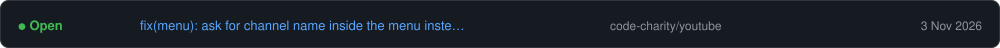

# About Me
Hi, I'm Shaikh Fardin, a UI/UX designer and software developer from India.
I design in Figma and build frontends in Flutter and Next.js. Co-Founder of Islamic Legacy.

🔗 [LinkedIn](https://www.linkedin.com/in/shaikh-fardin) · [X](https://x.com/srkianfardin) · shaikhfardin206@gmail.com

## Design

   

## Programming Languages

   

## Frameworks & Libraries

   

## Databases & Dev Tools

   

<!--CONTRIB:START-->

Last updated: 3 Nov 2026 · updates automatically every day
<!--CONTRIB:END-->
