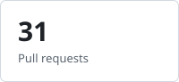
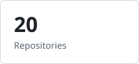
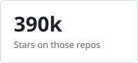
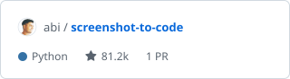
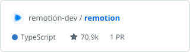
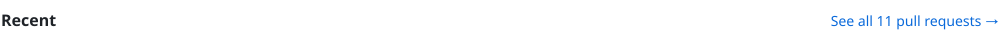

# About Me
Hi, I'm Shaikh Fardin, a UI/UX designer and software developer from India.
I design in Figma and build frontends in Flutter and Next.js. Co-Founder of Islamic Legacy.

🔗 [LinkedIn](https://www.linkedin.com/in/shaikh-fardin) · [X](https://x.com/srkianfardin) · shaikhfardin206@gmail.com

## Design

   

## Programming Languages

   

## Frameworks & Libraries

   

## Databases & Dev Tools

   

<!--CONTRIB:START-->
## Contributions

Fixes and features for open-source projects I use.

<a href="https://github.com/search?q=author%3AFardin7798+is%3Apr+-user%3AFardin7798&type=pullrequests&s=created&o=desc"><picture><source media="(prefers-color-scheme: dark)" srcset="contrib/dark/stat-prs.svg" /></picture></a>
<a href="https://github.com/search?q=author%3AFardin7798+is%3Apr+-user%3AFardin7798+is%3Amerged&type=pullrequests&s=created&o=desc"><picture><source media="(prefers-color-scheme: dark)" srcset="contrib/dark/stat-merged.svg" /></picture></a>
<a href="https://github.com/search?q=author%3AFardin7798+is%3Apr+-user%3AFardin7798+is%3Aopen&type=pullrequests&s=created&o=desc"><picture><source media="(prefers-color-scheme: dark)" srcset="contrib/dark/stat-open.svg" /></picture></a>
<a href="./CONTRIBUTIONS.md#repos"><picture><source media="(prefers-color-scheme: dark)" srcset="contrib/dark/stat-repos.svg" /></picture></a>
<a href="./CONTRIBUTIONS.md#repos"><picture><source media="(prefers-color-scheme: dark)" srcset="contrib/dark/stat-stars.svg" /></picture></a>

<a href="https://github.com/search?q=author%3AFardin7798+is%3Apr+-user%3AFardin7798+is%3Amerged&type=pullrequests&s=created&o=desc"><picture><source media="(prefers-color-scheme: dark)" srcset="contrib/dark/h-merged.svg" /></picture></a>

<a href="https://github.com/multica-ai/multica/pull/9920"><picture><source media="(prefers-color-scheme: dark)" srcset="contrib/dark/merged-0.svg" /></picture></a> 
<a href="https://github.com/code-charity/youtube/pull/4446"><picture><source media="(prefers-color-scheme: dark)" srcset="contrib/dark/merged-1.svg" /></picture></a> 
<a href="https://github.com/storytold/craft-anything/pull/670"><picture><source media="(prefers-color-scheme: dark)" srcset="contrib/dark/merged-2.svg" /></picture></a>

<a href="./CONTRIBUTIONS.md#repos"><picture><source media="(prefers-color-scheme: dark)" srcset="contrib/dark/h-repos.svg" /></picture></a>

<a href="https://github.com/abi/screenshot-to-code"><picture><source media="(prefers-color-scheme: dark)" srcset="contrib/dark/repo-0.svg" /></picture></a>
<a href="https://github.com/remotion-dev/remotion"><picture><source media="(prefers-color-scheme: dark)" srcset="contrib/dark/repo-1.svg" /></picture></a>
<a href="https://github.com/Alishahryar1/free-claude-code"><picture><source media="(prefers-color-scheme: dark)" srcset="contrib/dark/repo-2.svg" /></picture></a>

<a href="./CONTRIBUTIONS.md#pull-requests"><picture><source media="(prefers-color-scheme: dark)" srcset="contrib/dark/h-recent.svg" /></picture></a>

<a href="https://github.com/beenuar/AiSOC/pull/1688"><picture><source media="(prefers-color-scheme: dark)" srcset="contrib/dark/recent-0.svg" /></picture></a> 
<a href="https://github.com/Billionmail/BillionMail/pull/395"><picture><source media="(prefers-color-scheme: dark)" srcset="contrib/dark/recent-1.svg" /></picture></a> 
<a href="https://github.com/Crosstalk-Solutions/project-nomad/pull/1540"><picture><source media="(prefers-color-scheme: dark)" srcset="contrib/dark/recent-2.svg" /></picture></a> 
<a href="https://github.com/remotion-dev/remotion/pull/12936"><picture><source media="(prefers-color-scheme: dark)" srcset="contrib/dark/recent-3.svg" /></picture></a>

Updated daily · last update 4 Nov 2026

<!--CONTRIB:END-->
